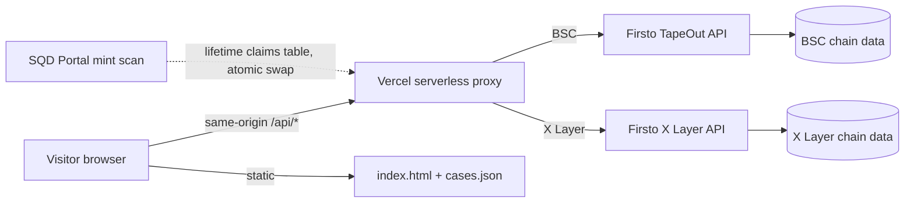

# 三账雷达 · TapeOut Whale Ledger

**One address in, three ledgers out.** TapeOut Whale Ledger reconciles every TapeOut wallet across its *machine* trades, *component* trades and *lifetime mining claims*, then classifies the player behind the address — because the public earnings leaderboard only reads the first ledger, and it is wrong about almost everyone on it.

输入任意钱包地址，三本账一次算清：机器买卖账、元件买卖账、一生累计领取的产出账——再判定这个地址到底是哪种玩家。


*Placeholder for the hero chart — the same five wallets ranked twice. Left: the public leaderboard (machine trades only). Right: the three-ledger ranking (machines − components + realized claims). The #1 "earner" drops below zero; the real #1 is invisible on the left. Final artwork to be dropped in at this path before launch.*

---

## The headline finding

We pulled the **complete on-chain history of the 184 largest TapeOut wallets (407,098 transactions)** and rebuilt every number from raw trades — no leaderboard figures were trusted. Re-ranking by realized three-ledger cash flow (claims valued at the period-average price of 0.0400 BNB/BEM) reshuffles the board completely:

| Wallet | Leaderboard view (BNB) | Three-ledger view (BNB) | Verdict |
|---|---|---|---|
| 案例钱包① · 0x48a4…912d | **+564.72** ("top earner") | **−99.80** visible, ≈ −91.80 incl. claims | Machine-building churner |
| 案例钱包② · 0x503a…2205 | +707.26 | **+668.77** | Low-cost multiplier |
| 案例钱包③ · 0x0c16…f753 | +6.66 (unranked) | **≈ +877 — the real #1** | Output holder |
| 案例钱包④ · 0x9561…8717 +1 | +633.70 ("earnings") | pass-through flow, not profit | Distribution channel |
| 案例钱包⑤ · 0x8baf…8c4f | 0 (never sold a machine) | ≈ −308 realized, ~1,928 in inventory | Capital-heavy stockpiler |

Case ① is the cautionary tale: +564.72 BNB of machine sales against **664.52 BNB of net component purchases** and only 151.60 BEM claimed in its lifetime. The leaderboard isn't lying about the sales — it's just reading one ledger of three. (Full anonymized case data: [`cases.json`](cases.json).)

## The three-ledger method

For any address, on BSC and X Layer:

1. **Machine ledger** — every machine bought and sold (price, counterparty side corrected against the global feed; the per-account feed's side labels are inverted and must not be trusted raw).
2. **Component ledger** — every NAND/LATCH trade: net component capital actually sunk into production, buy/sell counts, average entry price in the protocol's first 14 days.
3. **Output & inventory ledger** — lifetime BEM claimed (claims are mints from the zero address; precomputed by a full scan of the token contract's mint events), machines currently held, and a **fourth, soft ledger**: inventory value discounted by a hyperbolic liquidity-decay factor `D = 0.95 / (1 + 0.08 × r)`, where `r` = inventory value ÷ market 24h volume. The deeper your inventory is relative to what the market absorbs in a day, the less of it you could actually realize.

The sum is reported as a *visible floor* plus, where off-market volume can be inferred, an audit interval — never a single fake-precise number.

## Player classification — six archetypes + parallel tags

Order of adjudication is fixed; every threshold is calibrated on the full-population distribution (see *Credibility*), not hand-picked:

| Archetype | Signature |
|---|---|
| **Distribution channel** （出货通道） | Self-built ratio ≈ 0, zero machine buys, ≥ 20 sales, zero component trades — sells other people's machines |
| **Low-cost multiplier** （低成本倍数） | Component net ÷ sales gross ≤ 0.20, machine net ≥ 100 BNB, net ≥ 3× component input — entered at genesis prices, tiny capital, huge multiple |
| **Machine-building churner** （造机周转） | Self-built ≥ 0.80, gross component ratio ≥ 0.60, ≥ 25 sales — profit from build-and-flip turnover |
| **Output holder** （产出持有） | ≥ 40 machines held, sell-through rate ≤ 0.35 — builds/buys and holds for mining output |
| **Capital-heavy stockpiler** （重资本囤料） | Component net ≥ 100 BNB, zero machine sales, ≥ 10 held — capital parked in components and inventory |
| **Regular** （普通） | None of the above |

Parallel tags (stackable, not part of the order): **Upstream builder** （上游造机号）, **Off-market exposure undetermined** （场外敞口未定）, **Genesis price zone** （创世低价区）, **Source distribution — flow signature** （源头分发：元件净流出且买入占比 ≤ 0.30 的流量签名，不等于已证实的团队身份）.

## Features

- **Any-address verdict card** — three ledgers, archetype, and percentile context for every ratio (each number shown next to the population distribution it was judged against).
- **Order-book simulator** — walks the *real* live ask book (not recent trades), cheapest capacity first; shows payback days, share of 24h volume, and a traffic light. If your budget eats the entire snapshot it says so instead of fabricating fills, and a coverage indicator compares the snapshot's best price against the official market-wide best.
- **Anti-trap market card** — capacity price, payback days and market health for both chains before you spend anything.
- **Shareable report card** — one tap renders a vertical verdict image showing only the last 6 characters of the address.
- **Protocol checkup** — the original-vs-clone due-diligence view below, kept current from on-chain reads.

## The core thesis: why the original's data is worth reading — and the clone's isn't

This project exists because TapeOut's on-chain economy is real enough to audit. The same audit applied to its X Layer community clone (FabX/FAB) is exactly why we read the clone's *data* but would never trust its *numbers* the same way:

**The original (TapeOut / BEM, BSC)**
- Mining contract **sealed** on 2026-09-14; emissions fixed at 7,200 BEM/day on a published halving path to 2030-08-19.
- Real, measurable economy: 21,081 circuits, 1,650,392 H total weight, main pool liquidity ≈ $151K (≈ $282K across the top pools, 2026-11-16).
- Audit lineage exists: Salus audited v2.0.0 (report 2026-10-28).
- Official pool phase 1 live and producing (≈ 173.6 BEM/day); phase-2 raise disclosures match on-chain reads exactly (477 NAND read on-chain vs 477 disclosed).
- No referral / multi-level rebate mechanism found anywhere in the official surfaces.

**The clone (FabX / FAB, X Layer) — drawbacks, verified on-chain**
- **≈ 87.3% of total supply pre-minted at genesis to the deployer's personal EOA**, no lock-up.
- Mining contract **upgradeable and unsealed, owned by a personal private key** — the rules can change unilaterally at any time.
- No audit, no published halving schedule, anonymous team.
- Launched 2026-10-13; 7,006 miners / 732 holders — an order of magnitude thinner than the original.

**The original's own red lines — stated, not hidden**
- The factory contract is still upgradeable, held by a team 3/5 multisig — contradicting the whitepaper's "ownership fully renounced" framing.
- The live v2.3.0 code has **not** been externally re-audited (Salus covered v2.0.0 only; the 8 findings are self-declared fixed).
- Emissions are inflationary: cumulative burns (2,499.84 BEM) are under 5% of a single week's emissions — no deflationary offset.
- The official TapeOut-side pool still shows 0 registered miners; the token price is extremely volatile (−73.4% in 30 days at last check). None of this is softened in the app: the checkup card shows red lines for both protocols.

## Credibility — how the numbers earn trust

- **Calibration n = 108**: thresholds were fitted on every wallet with ≥ 10 BNB sales gross (the full effective whale population, 175 wallets' component histories pulled), not on a hand-picked few. Component-ratio distribution: P25 = −0.02, P50 = 0.03, P75 = 0.51.
- **Thresholds sit in data gaps, not on round numbers**: the churner line (0.60) sits in the empty 0.571–0.608 band and rescues a verified false negative at 0.6446; the multiplier line (0.20) sits above the continuous 0.050–0.186 qualified cluster; the holder sell-rate line (0.35) sits in the 0.323–0.378 gap.
- **Out-of-sample blind test**: 15 mid-tier wallets drawn with a fixed seed *after* calibration, list frozen before the run — **strict accuracy 13/15 = 86.7%** (93.3% counting marginal calls), top-5 by gross 5/5. Stated limitation: this tier produced only one active (non-"Regular") classification, so the test mostly proves the classifier doesn't pin whale labels on ordinary wallets; the three misses it did find (a scale-blind holder gate, a netted-ratio false negative, an unclassified source-distribution pattern) were fixed and re-verified with zero collateral flips across 190 wallets.
- **Golden regression set**: 38 addresses with frozen expected verdicts (benchmarks, blind-test cases, edge cases, and one known cross-chain miss kept as a negative sample) — every rule change must pass 38/38 before it ships.
- **Refused shortcuts, on record**: pricing un-started machines from gate counts would have fabricated prices 250× better than the market's best — rejected; a "net off-market machines" figure that no trade data can reproduce — rejected, replaced with a clearly-labelled component-inferred estimate.

## Architecture

Read-only. No wallet connection, no signing, no funds — ever.

| Layer | Source |
|---|---|
| Machine & component trades, portfolios, live ask book (BSC) | Firsto TapeOut API — `https://api-tapeout.firsto.ai` |
| Same, X Layer deployment | Firsto X Layer API — `https://xlayer-api-tapeout.firsto.ai` |
| X Layer chain reads | X Layer RPC `https://rpc.xlayer.tech` (chainId 196) |
| Lifetime claims precompute | SQD Portal scan of BEM mint (zero-address) events, checkpointed & resumable; table swapped in by atomic rename |
| Clone pool pricing | GeckoTerminal (X Layer FAB/BEM pool) |

Key contracts (BSC): BEM token `0x5ce033b2bfca3af30b3e8c8457deaf776a8b695a` · claims/output contract `0x7e2e0dc66a3bd9103e69b766afa62d9f7b697b46` · signed-ask exchange `0x81de876ab97c65f156d896a24a76d48c015e6b6e`.

The public deployment serves a thin proxy (`proxy/`) in front of the Firsto APIs — required because Firsto's CORS only allows its own domain — with per-IP rate limiting and the six case verdicts pre-cached so demo traffic never touches upstream quota.



Methodology receipts — calibration, blind test, rule-fix log, golden set — are published in [`research/`](research/README.md).

## Known limitations

- Off-market (OTC) transfers are invisible to trade data: affected verdicts are floors, and the app labels them as such instead of guessing.
- The X Layer API exposes no `creator` field, so the self-built axis cannot be computed there; money gates are BNB-calibrated and degrade on OKB markets. One X Layer whale is a *known* miss, kept in the golden set as a negative sample.
- The ask-book snapshot covers the first 60 pages (≈ 465 verified-output machines on BSC at last build); the coverage indicator on the simulator shows how its best price compares with the official market-wide figure (last build: −2.21%).
- Lifetime claims for arbitrary addresses depend on the precompute snapshot's timestamp, which the app displays.

## Deployment

Production shape: this repository deploys as a single Vercel project — `index.html` and `cases.json` are served statically, `api/[...slug].js` is the serverless proxy, `vercel.json` sets its limits. Import the repo in Vercel and deploy; no build step, no environment variables required for the same-origin setup.

Run the standalone proxy locally (Node ≥ 18, zero dependencies):

```bash
cd proxy && cp .env.example .env   # set ALLOWED_ORIGIN to your frontend origin
npm start                          # listens on :8787
```

See [`proxy/README.md`](proxy/README.md) for the full variable list. Competition entry for **TapeOut Accelerate (X Layer Build X)**; submission deadline 2026-12-07 23:59 UTC.

## Disclaimer

TapeOut Whale Ledger is a read-only analytics tool. Everything it shows is derived from public on-chain data and is provided for research and education. **Nothing here is investment advice.** Classifications are statistical descriptions of historical flow patterns, not identities, not accusations, and not predictions. Verify before you act; the authors hold no custody of, and cannot move, any assets.
